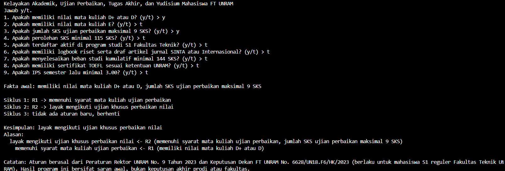
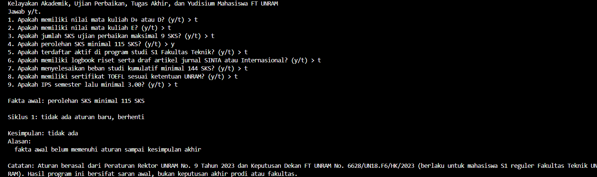
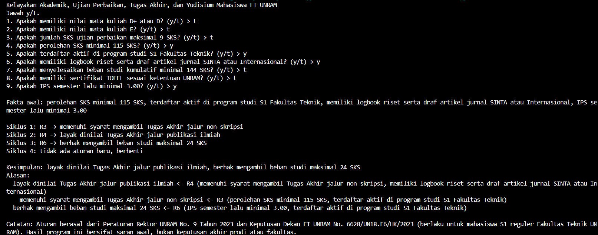

# Tugas 5 Kecerdasan Buatan - Sistem Pakar Sederhana

## 1. Nama dan NIM
Nama: Muhammad Zia Ul Haq
NIM: F1D02410125

## 2. Topik dan Cara Menjalankan Program
Topik: Kelayakan akademik, ujian perbaikan, tugas akhir, dan yudisium mahasiswa S1 Fakultas Teknik UNRAM.

Cara menjalankan program:
- Bahasa pemrograman: Python
- Versi: Python 3.14.7
- Perintah untuk menjalankan di terminal:
```bash
python main.py
```

## 3. Daftar Sumber dan Tabel Aturan

Daftar Sumber:
- S1: Peraturan Rektor Universitas Mataram Nomor 9 Tahun 2023 tentang Pedoman Akademik Universitas Mataram, Universitas Mataram, https://mti.if.unram.ac.id/wp-content/uploads/2023/12/Pedoman-Akademik-Unram-Perrek-No.-9-Tahun-2023.pdf (Diakses 11 November 2026)
- S2: Keputusan Dekan Fakultas Teknik Universitas Mataram Nomor 6628/UN18.F6/HK/2023 tentang Pedoman Tugas Akhir Mahasiswa Selain Skripsi/Tesis, Fakultas Teknik Universitas Mataram, https://mts.ft.unram.ac.id/wp-content/uploads/2024/06/Pedoman-Tugas-Akhir-selain-Skripsi_Tesis.pdf (Diakses 11 November 2026)

Tabel Aturan:

| Aturan | IF | THEN | Sumber |
| :--- | :--- | :--- | :--- |
| R1 | IF memiliki nilai mata kuliah D+ atau D OR memiliki nilai mata kuliah E | THEN memenuhi syarat mata kuliah ujian perbaikan | S1 |
| R2 | IF memenuhi syarat mata kuliah ujian perbaikan AND jumlah SKS ujian perbaikan maksimal 9 SKS | THEN layak mengikuti ujian khusus perbaikan nilai | S1 |
| R3 | IF perolehan SKS minimal 115 SKS AND terdaftar aktif di program studi S1 Fakultas Teknik | THEN memenuhi syarat mengambil Tugas Akhir jalur non-skripsi | S2 |
| R4 | IF memenuhi syarat mengambil Tugas Akhir jalur non-skripsi AND memiliki logbook riset serta draf artikel jurnal SINTA atau Internasional | THEN layak dinilai Tugas Akhir jalur publikasi ilmiah | S2 |
| R5 | IF menyelesaikan beban studi kumulatif minimal 144 SKS AND memiliki sertifikat TOEFL sesuai ketentuan UNRAM | THEN layak mengikuti yudisium program Sarjana | S1 |
| R6 | IF IPS semester lalu minimal 3.00 AND terdaftar aktif di program studi S1 Fakultas Teknik | THEN berhak mengambil beban studi maksimal 24 SKS | S1 |

## 4. Metode yang Dipilih dan Alasannya
Metode yang dipakai adalah Forward Chaining (FC). Alasannya karena di kasus ini mahasiswa sudah tahu data miliknya dari awal, seperti nilai mata kuliah, jumlah SKS, IPS semester lalu, dan syarat lainnya. Jadi program cukup menanyakan fakta awal tersebut, lalu mencocokkan aturan satu per satu sampai mendapat kesimpulan.

## 5. Tiga Kasus Uji dan Screenshot

| # | Jawaban "ya" | Kesimpulan yang diharapkan |
| :--- | :--- | :--- |
| 1 | memiliki nilai mata kuliah D+ atau D, jumlah SKS ujian perbaikan maksimal 9 SKS | layak mengikuti ujian khusus perbaikan nilai |
| 2 | perolehan SKS minimal 115 SKS saja | tidak ada (kasus negatif) |
| 3 | perolehan SKS minimal 115 SKS, terdaftar aktif di program studi S1 Fakultas Teknik, memiliki logbook riset serta draf artikel jurnal SINTA atau Internasional, IPS semester lalu minimal 3.00 | layak dinilai Tugas Akhir jalur publikasi ilmiah, berhak mengambil beban studi maksimal 24 SKS |

Kasus 1:


Kasus 2:


Kasus 3:


## 6. Batas Keberlakuan
Aturan pada program ini memakai pengetahuan dari Peraturan Rektor UNRAM Nomor 9 Tahun 2023 dan Keputusan Dekan FT UNRAM Nomor 6628/UN18.F6/HK/2023 untuk kondisi pengecekan syarat akademik mahasiswa S1 reguler di Fakultas Teknik Universitas Mataram. Hasil dari program ini hanya sebagai saran awal untuk mahasiswa, bukan keputusan akhir dari dosen pembimbing akademik atau pihak prodi.

## 7. Penggunaan Alat Bantu AI
Menggunakan Gemini untuk membantu mencari dokumen PDF pedoman akademik UNRAM dan contoh cara membaca file JSON di Python.